# Robotino: движение по траектории с навигацией по камере

<p>
  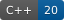
  
  
  
</p>

Это мой проект с учебной практики 2024 года в Томском политехническом университете (Инженерная школа информационных технологий и робототехники). Я написал на C++ программу, которая управляет всенаправленным мобильным роботом **Festo Robotino** и ведёт его по заданной траектории.

Положение робота я определяю **камерой, закреплённой над полигоном**. На роботе наклеен ArUco-маркер. Программа находит его на кадре с помощью OpenCV и вычисляет по нему координаты и угол поворота робота. Раз в 100 мс она пересчитывает вектор скорости и отправляет его роботу по Wi-Fi. Робот приходит в нужную точку, даже если его развернуть прямо во время движения: программа учитывает текущий угол поворота. Параллельно я записываю телеметрию моторов (положение, скорость, ток) в CSV-лог.

<p align="center">
  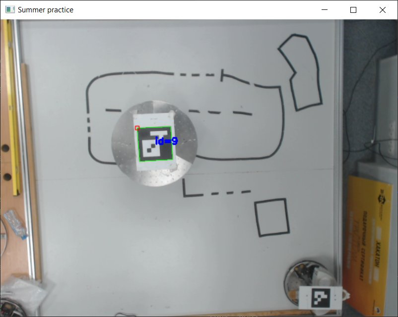
  <br><em>Окно программы: вид с камеры над полигоном, маркер на роботе распознан (id = 9)</em>
</p>

---

## Содержание

- [Что я сделал](#что-я-сделал)
- [Как это работает](#как-это-работает)
  - [Общая схема](#общая-схема)
  - [1. Сбор данных и логирование](#1-сбор-данных-и-логирование)
  - [2. Чтение кадров и распознавание маркера](#2-чтение-кадров-и-распознавание-маркера)
  - [3. Положение робота в глобальной системе координат](#3-положение-робота-в-глобальной-системе-координат)
  - [4. Управление движением](#4-управление-движением)
- [Структура проекта](#структура-проекта)
- [Сборка и запуск](#сборка-и-запуск)
- [Настройка](#настройка)
- [Результаты](#результаты)
- [Что можно улучшить](#что-можно-улучшить)
- [Источники](#источники)

---

## Что я сделал

- Подключил Robotino к компьютеру по Wi-Fi через **Robotino API2** и обработал события соединения и бампера.
- Настроил захват видео с USB-камеры и распознавание **ArUco-маркеров** (словарь `DICT_6X6_50`) в OpenCV.
- Задал **глобальную систему координат (ГСК)** полигона и научился находить в ней положение робота по центру маркера.
- По углам маркера вычисляю **угол поворота робота** и перевожу вектор скорости в локальную систему координат робота. Поэтому робот едет к цели при любой своей ориентации.
- Реализовал движение по замкнутой траектории из набора точек (по умолчанию квадрат) с обратной связью по камере.
- Сделал логирование телеметрии всех трёх моторов в CSV. Файлы раскладываются по папкам с датой запуска.
- Сделал остановку: программа завершается, если сработал бампер, пропала связь с роботом, нажата клавиша Esc или закрыто окно с видео.
- Если маркера нет на кадре, программа не падает: окно показывает исходный кадр, а функции координат и угла возвращают `NaN`. Обработки этого случая в управлении пока нет (см. «Что можно улучшить»).
- Добавил опциональную оценку позы маркера (`solvePnP`) по калибровочным параметрам камеры, с отрисовкой осей на кадре.

## Как это работает

### Общая схема

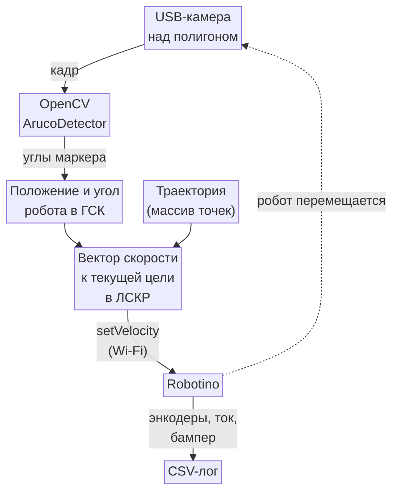

Главный цикл движения по траектории (`squareMovementUsingCamera()`) у меня устроен так:

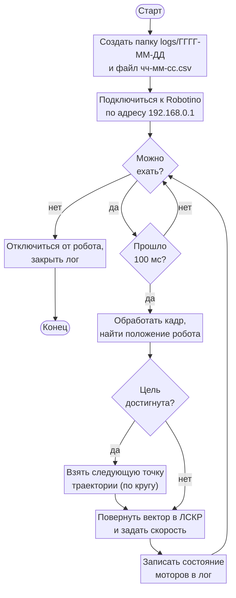

Полные условия из схемы:

- **«Можно ехать?»** — бампер не нажат, связь с роботом есть и не нажата клавиша Esc.
- **«Прошло 100 мс?»** — с прошлой итерации прошло больше `VELOCITY_UPDATE_LATENCY` = 100 мс.
- **«Цель достигнута?»** — расстояние от робота до текущей целевой точки меньше 3 px.

### 1. Сбор данных и логирование

Логирование я сделал максимально простым. При запуске создаётся папка с текущей датой, а в ней CSV-файл, названный по времени начала логирования (`logs/2024-12-17/13-04-11.csv`). При первой записи программа пишет заголовок и назначает объектам моторов номера 0, 1, 2. Дальше на каждой итерации цикла управления в файл добавляется строка с данными трёх моторов. Разделитель — `;`.

Колонки `M1`–`M3` в заголовке соответствуют моторам с номерами 0–2 в API. Логи, снятые до финальной версии (в том числе `logs/2024-12-17/13-04-11.csv`), содержат в `Time` интервал между записями, а не время от начала заезда; на графике ниже время получено накоплением.

| Время (мс) | Положение мотора (тики энкодера) | Скорость мотора (об/мин) | Ток мотора (А) |
|:---:|:---:|:---:|:---:|
| `Time` | `M1 pos`, `M2 pos`, `M3 pos` | `M1 vel`, `M2 vel`, `M3 vel` | `M1 cur`, `M2 cur`, `M3 cur` |

<p align="center">
  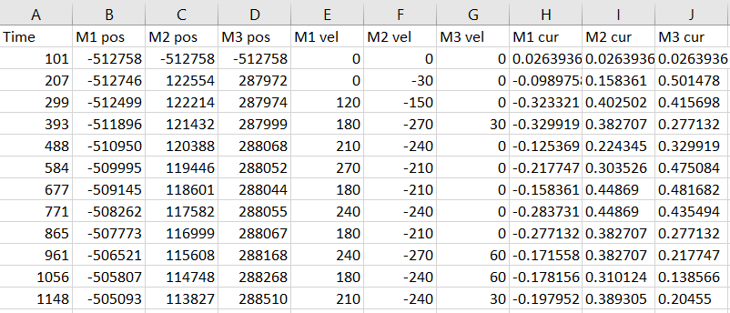
  <br><em>Фрагмент лог-файла, открытого в табличном редакторе</em>
</p>

За логирование отвечают функции `getLogPath()` и `logRobotinoState()` в [`main/src/util/logs.cpp`](main/src/util/logs.cpp).

### 2. Чтение кадров и распознавание маркера

Камеру я подключил к компьютеру по USB. Она висит над полигоном объективом вниз:

<p align="center">
  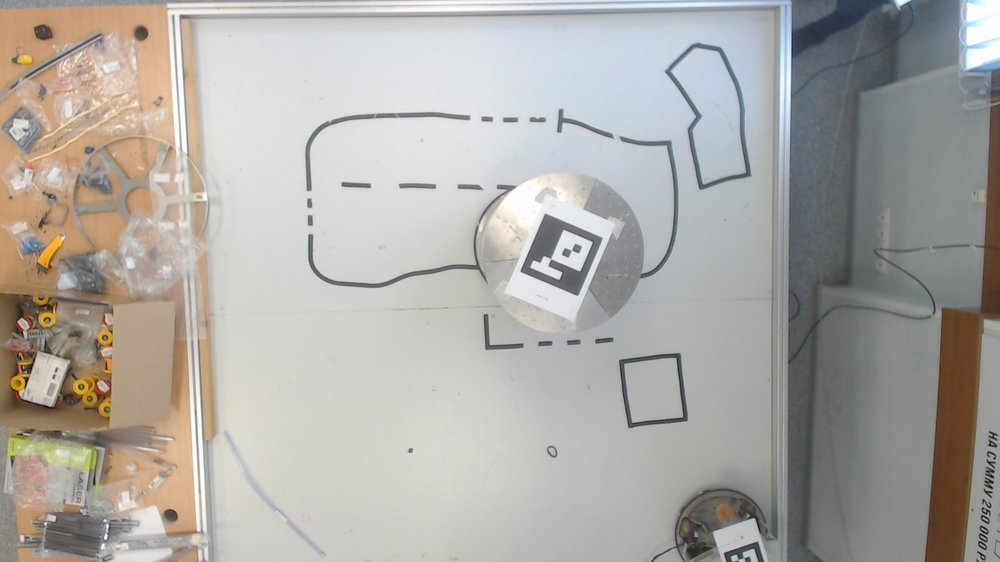
  <br><em>Исходный кадр с камеры: полигон, робот с ArUco-маркером</em>
</p>

Для работы с камерой я использую такие объекты:

| Объект | Тип | Назначение |
|---|---|---|
| `arucoDetector` | `cv::aruco::ArucoDetector` | Поиск ArUco-маркеров на кадре; создаётся со словарём `DICT_6X6_50` |
| `video` | `cv::VideoCapture` | Захват видеопотока; принимает индекс камеры (`CAMERA_INDEX`) |
| `image` | `cv::Mat` | Текущий кадр |
| `corners` | `std::vector<std::vector<cv::Point2f>>` | Координаты 4 углов каждого найденного маркера в системе координат изображения |
| `ids` | `std::vector<int>` | Идентификаторы найденных маркеров |

Кадр обрабатывает функция `processCameraImage()`:

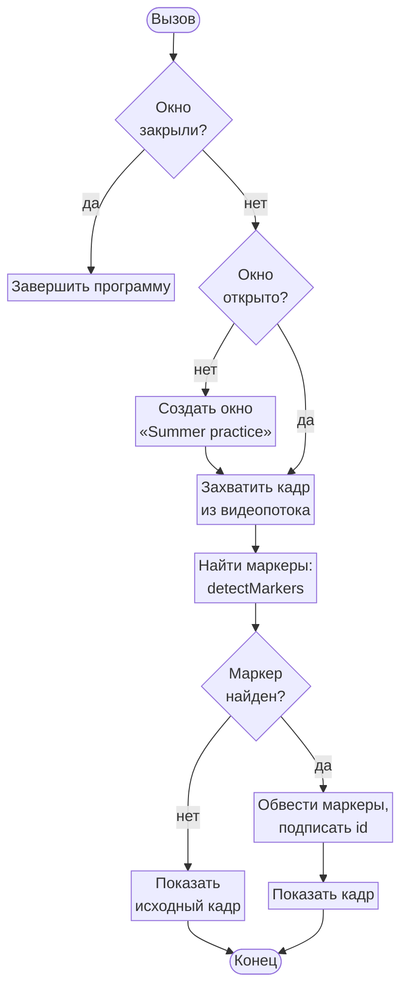

Полные условия из схемы:

- **«Окно закрыли?»** — окно было открыто при прошлом вызове, а сейчас его уже нет. Тогда я бросаю исключение, и оно перехватывается в `main()`.
- **«Окно открыто?»** — окно с видео уже существует.
- **«Маркер найден?»** — на кадре нашёлся хотя бы один ArUco-маркер (`ids` не пуст).

Координаты и угол робота по найденному маркеру возвращают функции `getCoordinatesFromImage()` и `getAngleFromImage()`. Если маркера на кадре нет, они возвращают `NaN`.

### 3. Положение робота в глобальной системе координат

**Мои допущения:**

- искажениями объектива я пренебрегаю;
- начало локальной системы координат робота (ЛСКР) совпадает с центром ArUco-маркера.

**Глобальная система координат.** В системе координат изображения (СКИ) ось $X$ направлена из левого верхнего угла вправо, ось $Y$ — вниз. Для ГСК я меняю оси местами: $X$ изображения становится $Y$ в ГСК, а $Y$ изображения — $X$ в ГСК. Начало ГСК находится в левом верхнем углу кадра.

<p align="center">
  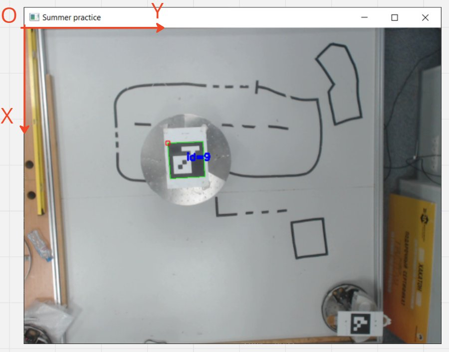
  <br><em>Глобальная система координат (ГСК), заданная на кадре</em>
</p>

За положение робота я принимаю точку пересечения диагоналей маркера. В коде это среднее четырёх углов, записанное с переставленными осями:

$$
\begin{pmatrix} X_w \\ Y_w \end{pmatrix} =
\begin{pmatrix} Y_i \\ X_i \end{pmatrix},
$$

где $(X_i, Y_i)$ — координаты центра маркера в СКИ, $(X_w, Y_w)$ — координаты робота в ГСК.

**Переход между ГСК и ЛСКР.** Пусть $\varphi$ — угол поворота осей робота относительно глобальных осей, а $(t_x, t_y)$ — положение начала ЛСКР в ГСК. Тогда точку из ГСК можно перевести в ЛСКР и обратно:

$$
\begin{pmatrix} X_l \\ Y_l \end{pmatrix} =
\begin{pmatrix} \cos\varphi & \sin\varphi \\ -\sin\varphi & \cos\varphi \end{pmatrix}
\begin{pmatrix} X_w - t_x \\ Y_w - t_y \end{pmatrix},
\qquad
\begin{pmatrix} X_w \\ Y_w \end{pmatrix} =
\begin{pmatrix} \cos\varphi & -\sin\varphi \\ \sin\varphi & \cos\varphi \end{pmatrix}
\begin{pmatrix} X_l \\ Y_l \end{pmatrix} +
\begin{pmatrix} t_x \\ t_y \end{pmatrix}.
$$

Матрица поворота ортогональна, поэтому обратная к ней равна транспонированной.

<table>
  <tr>
    <td align="center" width="50%">
      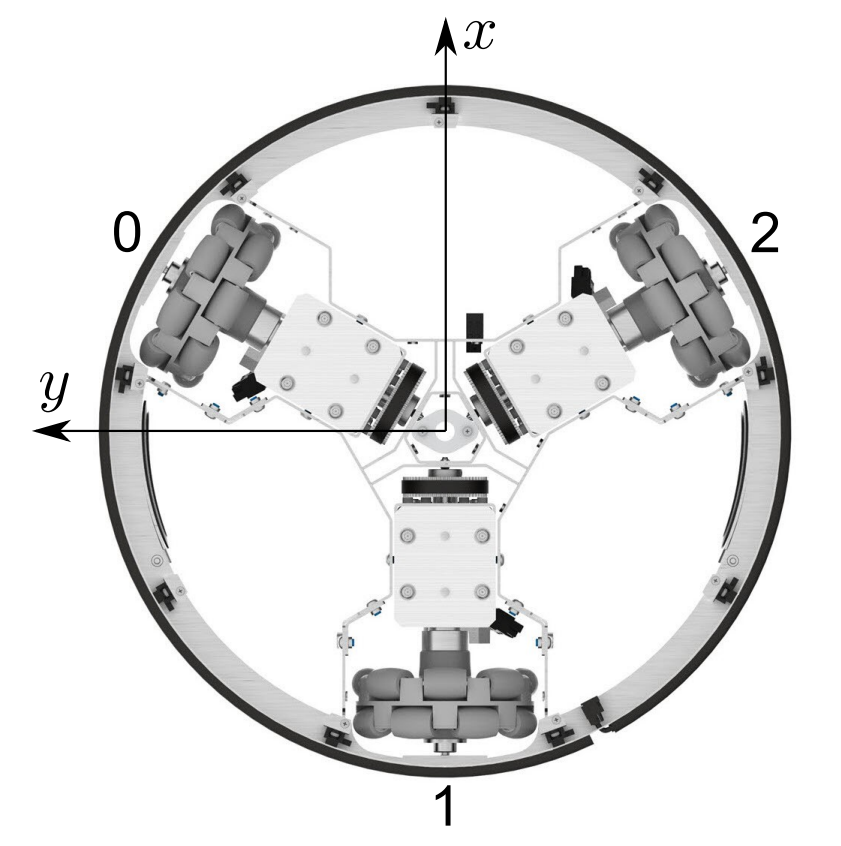<br>
      <em>ЛСКР по разметке на роботе: оси x, y и номера моторов 0, 1, 2</em>
    </td>
    <td align="center" width="50%">
      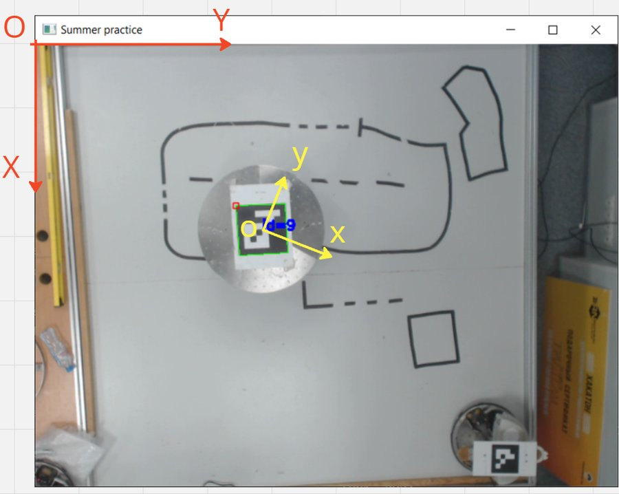<br>
      <em>ГСК (красная) и ЛСКР (жёлтая) на кадре с камеры</em>
    </td>
  </tr>
</table>

**Угол поворота робота.** Угол я нахожу по направлению стороны маркера от угла 0 к углу 1, переведённому в ГСК. Маркер наклеен на робота с поворотом относительно осей ЛСКР. Этот угол я измерил на роботе, он равен $\pi/6$, и я вычитаю его из угла маркера:

$$
\varphi = \operatorname{atan2}(\Delta Y_w,\ \Delta X_w) - \frac{\pi}{6},
$$

где $(\Delta X_w, \Delta Y_w)$ — вектор от угла 0 к углу 1 маркера в ГСК.

### 4. Управление движением

Robotino стоит на трёх omni-колёсах и может ехать в любом направлении, не разворачиваясь. Поэтому движение я задаю одним вектором скорости в ЛСКР — `OmniDrive::setVelocity(vx, vy, omega)`. Каждые `VELOCITY_UPDATE_LATENCY` = 100 мс программа заново вычисляет вектор в функции `setVelocity()`:

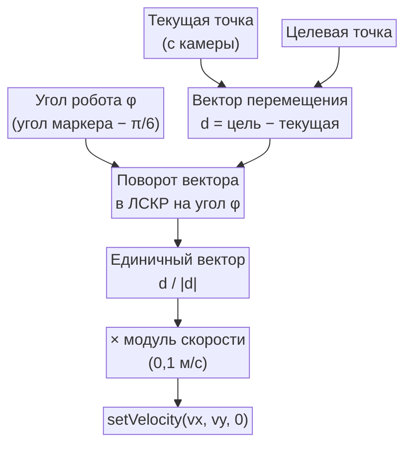

Сначала я перевожу вектор перемещения в ЛСКР, затем нормирую его и умножаю на нужную скорость:

$$
\vec d_l = R(\varphi)\,\bigl(\vec p_{\text{цели}} - \vec p_{\text{робота}}\bigr),
\qquad
\vec v = v \cdot \frac{\vec d_l}{\lVert \vec d_l \rVert},
$$

где $R(\varphi)$ — матрица поворота из формулы перехода ГСК → ЛСКР.

Угол пересчитывается на каждой итерации, поэтому робот держит направление на цель, даже если его повернуть во время движения. Мы проверяли это на практике: преподаватель разворачивал робота по-разному прямо на ходу, и он всё равно доезжал до нужной точки.

**Движение по траектории.** Траектория — массив точек в ГСК, в пикселях. Когда робот подъезжает к текущей цели ближе чем на 3 px, цель переключается на следующую точку. После последней точки обход начинается заново. По умолчанию робот ездит по квадрату:

```cpp
cv::Point2f points[4] = {
    cv::Point2f(200, 200),
    cv::Point2f(200, 400),
    cv::Point2f(400, 400),
    cv::Point2f(400, 200)
};
```


## Структура проекта

```
robotino-aruco-trajectory/
├── CMakeLists.txt              # корневой CMake-проект (C++20)
├── main/
│   ├── CMakeLists.txt          # цель robot_movement, поиск OpenCV и RobotinoAPI2
│   ├── main.cpp                # точка входа: подключение и движение по траектории
│   ├── include/
│   │   ├── api/
│   │   │   ├── Com.h           # обёртка над robotino::Com (события соединения)
│   │   │   └── Bumper.h        # обёртка над robotino::Bumper (событие касания)
│   │   ├── move/
│   │   │   └── movements.h     # setVelocity(), distance(), период обновления скорости
│   │   └── util/
│   │       ├── camera.h        # параметры камеры и маркера
│   │       └── logs.h          # путь к логам, заголовок CSV
│   └── src/
│       ├── api/                # Com.cpp, Bumper.cpp
│       ├── move/movements.cpp  # вектор скорости в ЛСКР, расстояние до цели
│       └── util/
│           ├── camera.cpp      # захват кадра, ArUco, координаты и угол робота
│           └── logs.cpp        # создание лог-файла, запись телеметрии
├── logs/                       # CSV-логи заездов, по папкам с датами
└── docs/images/                # иллюстрации для README
```

## Сборка и запуск

### Зависимости

| Компонент | Версия | Примечание |
|---|---|---|
| Windows + Visual C++ (MSVC) | VS 2019/2022 | камера открывается через DirectShow (`cv::CAP_DSHOW`) |
| CMake | ≥ 3.10 | |
| OpenCV | ≥ 4.7 | нужен класс `cv::aruco::ArucoDetector` из модуля `objdetect` |
| Robotino API2 | 64-bit | SDK от Festo/REC |

### Переменные окружения

| Переменная | Значение |
|---|---|
| `ROBOTINOAPI2_64_DIR` | папка установки Robotino API2 (в ней должна быть подпапка `cmake`) |
| `OpenCV_DIR` | папка с `OpenCVConfig.cmake` (например, `C:\opencv\build`) |

Вместо `ROBOTINOAPI2_64_DIR` путь можно передать прямо в CMake: `-DROBOTINOAPI2_DIR=...`.

### Сборка

```powershell
git clone https://github.com/Izolenty/robotino-aruco-trajectory.git
cd robotino-aruco-trajectory
cmake -S . -B build -A x64
cmake --build build --config Release
```

Я работал в **VS Code** с расширением CMake Tools. В `.vscode/settings.json` включено `cmake.configureOnOpen`, поэтому проект конфигурируется сразу при открытии папки.

### Запуск

1. Подключите компьютер к Wi-Fi сети Robotino (по умолчанию адрес робота `192.168.0.1`).
2. Подключите USB-камеру и закрепите её над полигоном.
3. Наклейте на робота ArUco-маркер из словаря 6×6 (`DICT_6X6_50`).
4. Проверьте, что DLL OpenCV и Robotino API2 доступны через `PATH`.
5. Запустите `build\main\Release\robot_movement.exe`.

Откроется окно **«Summer practice»** с видом с камеры, и робот поедет по точкам траектории. Остановить его можно клавишей Esc, нажатием на бампер или закрытием окна.

## Настройка

Основные параметры заданы макросами и константами:

| Параметр | По умолчанию | Описание |
|---|---|---|
| `ipAddress` | `"192.168.0.1"` | IP-адрес робота |
| `points[]` | квадрат 200×200 px | точки траектории в ГСК |
| скорость в `setVelocity(...)` | `0.1f` м/с | модуль скорости движения |
| порог расстояния | `3` px | когда переключаться на следующую точку |
| поправка угла маркера | `PI / 6` | поворот маркера относительно осей ЛСКР |
| `VELOCITY_UPDATE_LATENCY` | `100` мс | период обновления скорости |
| `CAMERA_INDEX` | `1` | индекс камеры для `VideoCapture` |
| `CAMERA_DELAY` | `5` | задержка `cv::waitKey` при показе кадра |
| `MARKER_LENGTH` | `0.1766` м | сторона маркера (нужна для `solvePnP`) |
| `ESTIMATE_POSE` | выключено | оценивать позу маркера и рисовать оси |
| `cameraIntrisics`, `distortionCoefs` | — | калибровочные параметры камеры |
| `ROOT_LOG_PATH` | `<корень проекта>/logs` | куда сохранять логи; задаётся в `main/CMakeLists.txt` при сборке, папки создаются сами |

## Результаты

Робот проезжает квадратную траекторию по обратной связи с камеры и доходит до каждой точки при любой своей ориентации. На графике ниже — данные одного мотора из реального заезда: за ~100 с робот сделал шесть кругов по квадрату. На каждом круге хорошо видны четыре участка (четыре стороны квадрата) с разной скоростью колеса.

<p align="center">
  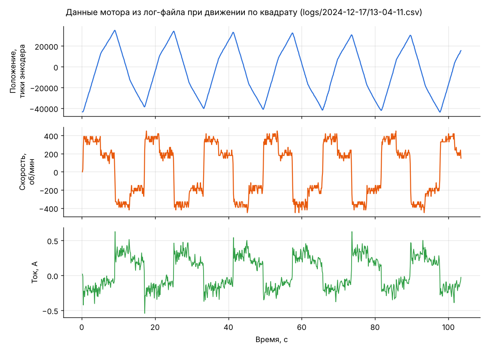
</p>

## Что можно улучшить

- **Перейти к метрам.** Сейчас координаты считаются в пикселях, а скорость задаётся в м/с. Чтобы считать всё в метрах, нужен масштаб полигона или полная оценка позы через `solvePnP` (в коде она уже есть, флаг `ESTIMATE_POSE`).
- **Учесть искажения камеры.** Калибровочные параметры уже записаны в коде, так что можно исправлять искажения кадра (`cv::undistort`) перед поиском маркера.
- **Вынести настройки.** IP робота, индекс камеры и точки траектории зашиты в код. Удобнее передавать их аргументами командной строки или читать из конфига.
- **Обработка потери маркера.** Сейчас при `NaN` в `setVelocity()` роботу уходит `NaN`; нужно останавливать робота. Там же стоит защититься от деления на ноль при `len = 0` и отправлять нулевую скорость при выходе из цикла.
- **Сложные траектории.** Следующий шаг — движение по более сложным фигурам, например по фигурам Лиссажу.

## Источники

1. Брылев О. А., Беляев А. С. *Всенаправленный мобильный колёсный робот Festo Robotino 4*: учебное пособие. — Томск, 2023. — 46 с.
2. [Геометрия формирования изображений](https://waksoft.susu.ru/2020/02/23/geometriya-formirovaniya-izobrazhenij/) — Записки преподавателя.
3. [Калибровка камеры с использованием OpenCV](https://waksoft.susu.ru/2020/02/29/kalibrovka-kamery-s-ispolzovaniem-s-opencv/) — Записки преподавателя.
4. [OpenCV: Detection of ArUco Markers](https://docs.opencv.org/4.x/d5/dae/tutorial_aruco_detection.html)

---

**Автор:** Мунконов Нима Евгеньевич, группа 8Е22, ТПУ
**Руководитель практики:** Беляев А. С., к.т.н., старший преподаватель ОАР
